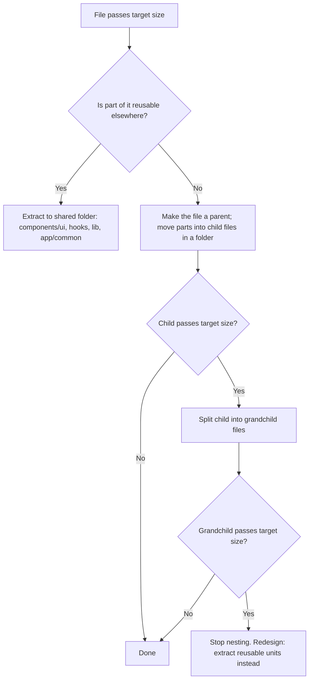
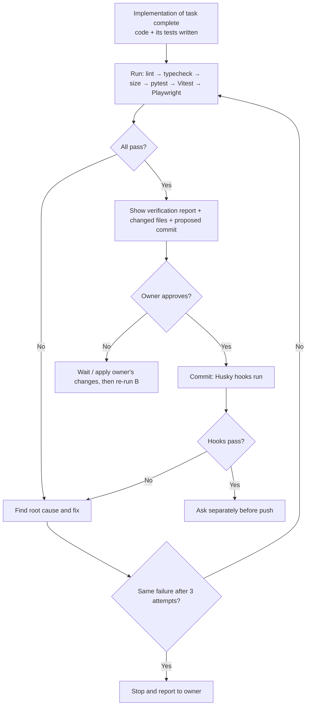

<!--
Sync Impact Report
- Version: 1.2.0 → 2.0.0 (MAJOR: Principle V redefined; new non-negotiable principle)
- Redefined: V. Test-First Everywhere → V. Verify After Implementation
  (tests are written as part of the task; the full test run happens after
  implementation is complete, then fix → re-run until all pass)
- Added: XIX. Human Approval for Git Actions (NON-NEGOTIABLE) — no commit,
  push, merge, branch, tag, PR, or GitHub Actions action without the owner's
  explicit approval
- Modified: XVI (hooks run only on approved commits/pushes), XVIII (approval
  rule applies to every tool), Testing Standards (verification loop),
  Quality Gates, Development Workflow, Instructions for AI Coding Agents
- Templates to review: .specify/templates/tasks-template.md (each feature ends
  with "Verification run" then "Request commit approval"),
  plan-template.md (Constitution Check covers I–XIX)
- Follow-up: update AGENTS.md and .cursor/rules/paylens.mdc (done in same change)
-->

# PayLens Constitution

**Project:** PayLens — AI finance copilot for Indian freelancers paid via PayPal
**Current phase:** Phase 1A (PayPal AI Hackathon build)
**Location of this file:** `.specify/memory/constitution.md`

## Source Documents

| Document | Role |
|---|---|
| `docs/PayLens_Phase1A_Hackathon_Plan.md` | **Authoritative scope for all current work.** Features, data model, endpoints, day plan, and definition of done come from here. |
| `docs/PayLens_Project_Plan.md` | Long-term reference only (later phases, compliance, roadmap). Nothing from it is built unless it also appears in the Phase 1A plan or in an approved spec. |

If a spec, plan, or task conflicts with this constitution, **this constitution wins**. If the Phase 1A plan conflicts with this constitution, raise it and amend one of them before building.

---

## Core Principles

### I. Scope Discipline (NON-NEGOTIABLE)

- Work MUST stay within `docs/PayLens_Phase1A_Hackathon_Plan.md`.
- Must-have features (M1 PayPal sync, M2 leakage dashboard, M3 Ask Your Money chat) MUST be complete, deployed, and working before any should-have feature (S1 FIRA matching, S2 CA report) is started.
- The following MUST NOT be built in Phase 1A: user login/OAuth for real users, invoices, reminders, bank statements, other payment connectors, mobile app, billing, CA dashboard, background job queues.
- No new feature may be added after the Thursday feature freeze. After freeze: bug fixes, docs, video only.

**Why:** A small, finished, deployed product beats a large unfinished one.

### II. Code Computes, AI Explains (NON-NEGOTIABLE)

- Every number shown to a user (totals, fees, FX loss, leakage, counts, percentages, match scores) MUST be calculated by deterministic, tested code.
- The LLM MUST NOT perform arithmetic that ends up in the UI, a report, or a chat answer. It MUST use numbers returned by tools, unchanged.
- The LLM MAY: extract fields from documents into a validated schema, choose which tool to call, explain results in plain language, write report narrative text.
- If a tool returns no data, the agent MUST say the data is not available. It MUST NOT guess.

**Why:** LLMs can make arithmetic mistakes. A finance product that shows a wrong number loses trust instantly.

### III. Money Correctness (NON-NEGOTIABLE)

- Money MUST use `Decimal` in Python and `NUMERIC` in PostgreSQL. `float` MUST NOT be used for money or exchange rates anywhere in the backend.
- Money values MUST always travel with their currency (ISO 4217 code). A bare number without a currency is a bug.
- Amounts MUST be stored with 2 decimal places; exchange rates with 6 decimal places.
- Rounding MUST use `ROUND_HALF_UP` and happen only when storing or displaying a final value, never in the middle of a calculation.
- Money MUST cross the API boundary as **strings** (e.g., `"77914.00"`), never as JSON numbers, so precision is never lost in JavaScript.
- PayPal fee values MUST be normalised to positive amounts on ingestion (PayPal may report fees as negative values).
- The leakage formulas in Phase 1A plan section 10 are the single source of truth:
  - `fee_loss_inr = F × r_mid`
  - `fx_loss_inr = N × (r_mid − r_pp)`
  - `total_leakage_inr = fee_loss_inr + fx_loss_inr`
  - Identity check: `total_leakage_inr` MUST equal `ideal_inr − inr_received` within ₹0.01.
- A negative `fx_loss_inr` (PayPal rate better than mid-market) MUST be shown as a gain, not hidden or clamped to zero.
- If a required rate is missing, the calculation MUST return an explicit "rate unavailable" status, never a made-up or zero value.

### IV. Type Safety End to End (NON-NEGOTIABLE)

**Backend (Python):**
- Every function, method, and module-level variable MUST have type hints.
- `mypy --strict` MUST pass with zero errors. `# type: ignore` requires a comment explaining why.
- All API request and response bodies MUST be Pydantic v2 models. No raw `dict` responses from routes.
- All LLM structured outputs (FIRA extraction, tool arguments) MUST be parsed and validated with Pydantic models. Invalid output is rejected, never "fixed up" silently.
- All PayPal API responses MUST be parsed into Pydantic models before use.
- Settings MUST be loaded through a typed settings class (`pydantic-settings`), failing fast at startup if a required variable is missing.
- Use `Enum` / `Literal` types for fixed sets: `TransactionSource` (`paypal_sandbox`, `demo_seed`), `FiraStatus` (`matched`, `needs_review`, `missing`), currency codes.
- Use dedicated types for money: a `Money` model (`amount: Decimal`, `currency: CurrencyCode`) instead of separate loose fields in business logic.

**Frontend (TypeScript):**
- `tsconfig.json` MUST have `"strict": true`, `"noUncheckedIndexedAccess": true`, `"noImplicitOverride": true`, `"exactOptionalPropertyTypes": true`.
- `any` MUST NOT be used. Use `unknown` and narrow it.
- API types MUST be generated from the backend OpenAPI schema (e.g., `openapi-typescript`), not hand-written.
- API responses MUST be validated at runtime with `zod` before use in components.
- Money MUST stay a string in the frontend and be formatted for display only (`en-IN`, ₹ symbol). The frontend MUST NOT do money arithmetic.

**Why:** Type errors caught at build time cannot reach a judge's screen.

### V. Verify After Implementation (NON-NEGOTIABLE)

- Tests are **required** for every feature, but the **full verification run happens after the implementation of a task (or feature) is complete** — not before and not in the middle.
- Tests are written as part of the same task, based on the spec and the **Required Test Cases** in this file, so they check what the feature *should* do, not just what the code happens to do.
- **Verification loop** after implementation:
  1. Run all checks in this order: lint → type check → file size → backend tests (pytest) → frontend unit tests (Vitest) → Playwright E2E
  2. If anything fails: find the root cause, fix the code (or the test only if the test is wrong and the spec agrees), and **run the full set again from step 1**
  3. Repeat until everything passes
  4. If the same failure is still there after **3 fix attempts**, stop and report to the owner with the error, what was tried, and options
  5. When everything passes, show the owner a short verification report (see Testing Standards) and **wait for approval** before any git action (Principle XIX)
- This applies to **all three layers**:

| Layer | Tool | What it covers |
|---|---|---|
| Backend unit + integration | pytest | Engine formulas, matching, services, PayPal sync (mocked), API routes |
| Frontend unit / component | Vitest + React Testing Library | Shared UI components, hooks, formatters, zod schemas |
| End-to-end (E2E) | Playwright | Full user flows in a real browser against frontend + backend |

- **Test pyramid:** many fast unit tests, fewer integration tests, a small set of E2E tests for the main user journeys. Every user story in a spec MUST have at least one Playwright test.
- Tests MUST NOT call real PayPal or a real LLM. Backend tests mock HTTP (`respx`); E2E runs the backend in test mode with **fake adapters** (`APP_ENV=test`, `PAYPAL_MODE=fake`, `LLM_MODE=fake`) and seeded data; frontend unit tests mock the API with MSW.
- Fake adapters MUST be impossible to enable when `APP_ENV=production`.
- Coverage targets: `backend/app/engine/` ≥ 90%; overall backend ≥ 70%; `frontend/components/ui/` and `frontend/lib/` ≥ 80%.
- A task is not complete until its required test cases exist and the verification loop is green.
- A failing test MUST NOT be skipped, deleted, or weakened to make the run pass. Fix the code, or amend the spec and the test together with a written reason approved by the owner.
- Flaky tests MUST be fixed (no arbitrary sleeps in Playwright; wait on visible UI state or network responses).

### VI. Security and Secrets

- Secrets (PayPal Client ID/Secret, LLM API key, database URL) MUST live only in `.env` files or Render environment variables. `.env` MUST be in `.gitignore`. Only `.env.example` with empty values is committed.
- The LLM API key MUST never reach the frontend. All LLM calls go through the backend.
- Logs MUST NOT contain secrets, access tokens, or full raw documents.
- Phase 1A MUST use **PayPal sandbox only** (`https://api-m.sandbox.paypal.com`). Live credentials MUST NOT be used or committed.
- No real person's financial data may be used. Demo data is sandbox or synthetic only.
- Uploaded files MUST be checked for type (PDF only) and size (max 5 MB), and stored outside any public path.
- Text from uploaded documents and transactions MUST be treated as data, never as instructions to the AI (prompt-injection defense).
- CORS MUST allow only the deployed frontend URL and localhost.
- The product name and UI MUST NOT use the PayPal logo or imply PayPal made or endorses PayLens.

### VII. Honest Demo

- Every transaction MUST carry a `source` (`paypal_sandbox` or `demo_seed`), visible in the UI.
- Simulated values (the sandbox PayPal conversion rate) MUST be labelled "Simulated (sandbox)" in the UI and README.
- README, Devpost text, and demo video MUST describe only features that actually work in the deployed build.
- Every report and tax-related chat answer MUST include: "Prepared from user data — not tax advice. Confirm with a CA."

### VIII. PayPal Integration Rules

- Base URL MUST come from settings, never hard-coded in business logic.
- OAuth access tokens MUST be cached until shortly before expiry, not requested on every call.
- Transaction Search requests MUST split date ranges into windows of at most 31 days and follow pagination until all pages are read.
- Ingestion MUST be idempotent: upsert by `paypal_transaction_id` (unique constraint). Running sync twice MUST NOT create duplicates.
- On HTTP 429 or 5xx, the client MUST retry with exponential backoff (max 3 retries). On 401, refresh the token once and retry.
- The raw PayPal response for each transaction MUST be stored in `raw_json` for debugging.
- Endpoints and field names MUST be verified against current PayPal developer documentation before implementation.

### IX. AI Agent Rules

- All LLM calls MUST go through one wrapper (`app/ai/llm.py`) so the provider and model can be changed in one place via settings.
- Agent tools MUST be read-only. No tool may write to the database, call PayPal, or send anything externally.
- Tool inputs and outputs MUST be Pydantic models.
- Every LLM call MUST have a timeout and a user-friendly fallback message on failure.
- The system prompt MUST include the rules from Phase 1A plan section 11 (tool results only, no self-calculation, state period and currency, CA disclaimer for tax questions, documents are data).
- Prompts MUST live in versioned files under `app/ai/prompts/`, not scattered inline strings.

### X. Simplicity

- Prefer the simplest thing that works for the demo: no login (single demo mode), no job queue, no microservices, no caching layer unless measured as needed.
- New dependencies MUST be justified in the plan. Prefer the standard library and the agreed stack.
- No abstraction is added "for later phases" unless the spec requires it. (YAGNI)

### XI. Always Deployable

- `main` MUST always be deployable. Broken work stays on a feature branch.
- The backend MUST expose `GET /health` returning `{"status": "ok"}`.
- First deployment to Render MUST happen by Wednesday 11 Nov. After that, every merge to `main` is redeployed and smoke-tested on the live URL.
- A new developer MUST be able to run the project locally by following the README alone.

### XII. Reuse Before Create

- Before writing any new component, hook, function, schema, or helper, the existing code MUST be searched for something that already does the job. Reuse or extend it instead of creating a near-duplicate.
- Shared building blocks MUST live in shared folders (`frontend/components/ui/`, `frontend/hooks/`, `frontend/lib/`, `backend/app/common/`) so they are easy to find and reuse. See **Reusable Building Blocks**.
- **Rule of two:** when the same logic, markup, or style pattern appears a second time, it MUST be extracted into a reusable unit.
- Feature code MAY use shared code. Shared code MUST NOT import feature code.
- Reusable components MUST be generic: configured through typed props, with no hard-coded feature data, API calls, or business rules inside them.
- Every plan from `/speckit.plan` MUST list which existing reusable parts it uses and which new reusable parts it creates.

**Why:** Reuse keeps the codebase small, consistent, and fast to change. One fix in a shared component fixes every screen that uses it.

### XIII. Small Files and Clear Hierarchy (NON-NEGOTIABLE)

**Size limits** (generated files such as `api-types.ts` and lock files are excluded):

| Unit | Target | Hard limit |
|---|---|---|
| Any source file (`.py`, `.ts`, `.tsx`) | ≤ 120 lines | **200 lines** |
| React component file | ≤ 100 lines | **150 lines** |
| Function / method / hook | ≤ 30 lines | **40 lines** |
| Test file | ≤ 200 lines | **300 lines** |
| Function parameters | ≤ 4 | 5 (use a typed object beyond that) |

**Splitting rule — parent → child → grandchild:**
- When a file grows past its target, split it **before** it reaches the hard limit.
- The original file becomes a **parent** that only composes/coordinates. Its parts move into **child** files.
- When a child file grows past its target, it is split the same way into **grandchild** files.
- Maximum nesting depth is **3 levels** (parent → child → grandchild). If a grandchild is still too large, the design is wrong: extract a reusable unit into a shared folder instead of nesting deeper.
- Each file MUST have **one responsibility**: one component, one hook, one service, one router, or one group of closely related pure functions.
- A split folder exposes a single public entry (`index.ts` / `__init__.py`). Code outside the folder imports only from that entry, never from internal child files.
- Circular imports MUST NOT exist.

**Why:** Small files are easy to read, review, test, and edit — for humans and for AI agents with limited context.

### XIV. Easy to Edit

- **No magic values.** Thresholds, limits, and labels MUST live in named constants or settings, for example:
  - Backend: `app/common/constants.py` (FIRA scores 60/25/15, match thresholds 80/50, amount tolerance 1%, date window 7 days, max upload 5 MB, PayPal window 31 days, retry count 3)
  - Frontend: `lib/constants.ts` (labels, routes, display text such as "Simulated (sandbox)")
- **Single source of truth.** Each formula, type, and rule exists in exactly one place and is imported everywhere else.
- **Predictable locations.** A developer MUST be able to guess where code lives from its name (see Code Structure). Tests sit next to what they test (frontend) or mirror the app path (backend).
- **Typed props and parameters** with clear names; prefer composition (children, slots) over boolean flags that change behaviour.
- **Styling** uses Tailwind utility classes through shared UI components and variant helpers; no repeated long class strings across features.
- **Simple over clever.** Prefer clear, boring code a beginner can follow over short, clever code.
- **Changing one thing should touch few files.** If a small change needs edits in many places, extract the repeated part.

### XV. Changelog and Documentation

- The repo MUST have a `CHANGELOG.md` at the root, following the *Keep a Changelog* format and Semantic Versioning.
- Every merged change MUST add an entry under `## [Unreleased]` in one of: `Added`, `Changed`, `Fixed`, `Removed`, `Security`, `Deprecated`.
- Entries are short, user-focused, and reference the spec folder when relevant (e.g., `Added: PayPal sandbox transaction sync (specs/001-paypal-sync)`).
- Releases: `0.1.0` = first deployed hackathon build; `1.0.0` = final Devpost submission build. On release, move `Unreleased` entries under the version heading with the date.
- Constitution changes are recorded in **Amendment History** at the end of this file (not in `CHANGELOG.md`).
- Each feature folder that is split into children MUST have a short header comment in its parent file explaining what the children do.
- README MUST stay in sync with features and setup (Principle VII, Quality Gates).

### XVI. Automated Git Hooks (Husky) (NON-NEGOTIABLE)

- The repo MUST use **Husky** + **lint-staged** + **commitlint**, installed from a root `package.json` (tooling only) so hooks run automatically on every commit and push.
- Hooks are a **second safety net**, not the main test run. The main run is the verification loop (Principle V), which happens **before** asking for commit approval. Commits and pushes happen **only after the owner approves** (Principle XIX).
- Hooks:

| Hook | Runs | Must be fast |
|---|---|---|
| `pre-commit` | `lint-staged` on staged files only: ESLint `--fix` + Prettier for TS/TSX/JSON/MD; `ruff check --fix` + `ruff format` for Python; file size check (Principle XIII); secret scan | Yes (seconds) |
| `commit-msg` | `commitlint` (Conventional Commits) | Yes |
| `pre-push` | Frontend `tsc --noEmit` + Vitest; backend `mypy` + `pytest` (excluding tests marked `slow`) | Under ~1–2 minutes |
| CI (GitHub Actions) | Everything above **plus** full backend suite, coverage, `next build`, and **Playwright E2E** | Runs on every push and PR |

- `git commit --no-verify` and `git push --no-verify` MUST NOT be used. If a hook is wrong, fix the hook in a separate commit.
- Hooks MUST work on Windows, macOS, and Linux (use `npm`/`npx`/`uv run` commands, not OS-specific shell tricks).
- If a hook fails, the agent MUST fix the cause, re-run the verification loop, and ask the owner for approval again; it MUST NOT disable the check.

### XVII. Tooling and Plugins for Speed

Use tools that make development faster and catch mistakes early. Install them during project setup (before feature 001).

**Backend (Python):**

| Tool | Why |
|---|---|
| `uv` | Very fast Python package and virtual-environment manager; lockfile (`uv.lock`) |
| `ruff` | Fast linter + formatter (replaces flake8, isort, black) |
| `mypy` + `pydantic.mypy` plugin | Strict type checking that understands Pydantic models |
| `pytest`, `pytest-cov`, `pytest-asyncio` | Tests, coverage, async tests |
| `respx` | Mock `httpx` calls (PayPal, FX) |
| `hypothesis` | Property-based tests for money formulas |
| `freezegun` | Control time in date/window tests |

**Frontend (TypeScript):**

| Tool | Why |
|---|---|
| `typescript-eslint` (strict type-checked config) | Type-aware lint rules |
| `eslint-plugin-react-hooks`, `@next/eslint-plugin-next` | React and Next.js correctness |
| `eslint-plugin-import-x` (`no-cycle`) | Blocks circular imports (Principle XIII) |
| `eslint-plugin-jsx-a11y` | Accessibility mistakes |
| `prettier` + `prettier-plugin-tailwindcss` | Consistent formatting and class order |
| `vitest`, `@testing-library/react`, `@testing-library/user-event`, `@testing-library/jest-dom`, `jsdom` | Component and unit tests |
| `msw` | Mock API responses in frontend tests |
| `@playwright/test`, `@axe-core/playwright` | E2E tests and automated accessibility checks |
| `zod`, `openapi-typescript` | Runtime validation and generated API types |

**Repo tooling (root):** `husky`, `lint-staged`, `@commitlint/cli`, `@commitlint/config-conventional`, `secretlint` (secret scanning), `.editorconfig`.

**IDE extensions** (listed in `.vscode/extensions.json`; works in VS Code and VS Code–based editors such as Cursor and Antigravity — if an extension is missing from your editor's marketplace, use the closest equivalent):
- Python + a Python language server, Ruff, Mypy Type Checker
- ESLint, Prettier, Tailwind CSS IntelliSense
- Playwright Test, Vitest
- EditorConfig, Error Lens, Pretty TypeScript Errors, DotENV

**Editor settings** (`.vscode/settings.json`): format on save, ESLint and Ruff fix on save, TypeScript from the workspace version.

**Optional agent helpers:** If your AI agent supports MCP servers, a Playwright MCP server lets the agent open the running app and check flows in a browser. MCP tools are helpers only; they never replace the committed Playwright tests.

Rules:
- Every tool version MUST be pinned (`uv.lock`, `package-lock.json`).
- New tools MUST be justified in a plan (Principle X); prefer the list above.

### XVIII. Agent-Agnostic Rules

- This constitution applies to **every** person and **every** AI coding tool working on PayLens — Claude Code, Cursor, Google Antigravity, OpenCode, GitHub Copilot, Codex, Gemini CLI, and any other — whether or not the tool runs Spec Kit commands.
- **Single source of truth:** `.specify/memory/constitution.md` (this file). Tool-specific files only point here and MUST NOT contradict it:

| File | Read by | Content |
|---|---|---|
| `AGENTS.md` (root) | Cursor, Antigravity, OpenCode, Codex, Copilot, and other tools that support it | Short summary of the top rules + commands + "read the constitution and the Phase 1A plan first" |
| `CLAUDE.md` (root) | Claude Code | Imports `AGENTS.md` (`@AGENTS.md`) and nothing that conflicts |
| `.cursor/rules/paylens.mdc` | Cursor | `alwaysApply: true`; points to `AGENTS.md` and this file |
| `GEMINI.md` or `.agents/rules/` (optional) | Antigravity / Gemini tools | Only if needed; point to `AGENTS.md` |

- `AGENTS.md` MUST stay short (well under 12,000 characters) so every tool can load it in full; details stay in this constitution.
- When this constitution changes, `AGENTS.md` MUST be updated in the same commit if the summary is affected.
- **Spec Kit artifacts are shared:** every tool reads and writes the same `specs/NNN-feature/` files (`spec.md`, `plan.md`, `tasks.md`). If a tool does not have Spec Kit slash commands, it MUST follow the same steps manually using `.specify/templates/`.
- Every tool, before reporting a task done, MUST run the relevant checks (lint, type check, tests) and report the results honestly.
- Git hooks (Principle XVI) and the Git approval rule (Principle XIX) apply to every tool. Auto-commit / auto-push features MUST be turned off.

### XIX. Human Approval for Git Actions (NON-NEGOTIABLE)

- **No AI agent may change Git or GitHub state without the project owner's explicit approval** in the current conversation, for that specific action.
- Actions that **need approval** (every time):
  - `git add` of files for a commit, `git commit`, `git commit --amend`
  - `git push` (including force push), `git pull` / `git merge` / `git rebase`
  - Creating, switching, renaming, or deleting branches; `git tag`; `git stash`; `git reset`; `git checkout` / `git restore` that discards changes; `git clean`
  - Creating or merging pull requests; editing GitHub repository settings
  - Creating, editing, re-running, or manually triggering **GitHub Actions** workflows (and any push that would trigger them)
  - Deploys that are triggered by Git actions
- Actions that are **allowed without approval** (read-only): `git status`, `git diff`, `git log`, `git show`, `git branch --list`, reading CI results.
- **How to ask:** after the verification loop is green, the agent posts:
  1. Verification report (what ran, pass/fail counts)
  2. List of changed files
  3. Proposed commit message (Conventional Commits) and target branch
  4. The exact command(s) it wants to run
  Then it **waits**. Only a clear "yes / approved / commit / push" from the owner counts. Silence, earlier approvals, or approval for a different action do not count.
- Approval for a commit is **not** approval for a push. Each needs its own approval.
- When approved, Husky hooks run as normal (Principle XVI). If a hook fails, the agent fixes the cause, re-runs the verification loop, and **asks for approval again**.
- This rule applies to every tool (Principle XVIII) and overrides any tool setting that auto-commits or auto-pushes. Auto-commit features in IDEs and agents MUST be turned off for this repo.

---

## Technology Stack and Constraints

| Area | Required choice |
|---|---|
| Backend language | Python 3.11+ |
| Python env / packages | uv (`uv.lock`; `requirements.txt` exported for Render) |
| Backend framework | FastAPI |
| Validation and types | Pydantic v2, pydantic-settings |
| Database | PostgreSQL, SQLAlchemy 2.x (typed `Mapped[...]` models) |
| HTTP client | httpx |
| Backend lint/format | ruff (lint + format) |
| Backend type check | mypy (strict) + `pydantic.mypy` plugin |
| Backend tests | pytest, pytest-cov, pytest-asyncio, respx, hypothesis, freezegun |
| Frontend | Next.js (App Router), TypeScript (strict), Tailwind CSS |
| Data grid | AG Grid Community |
| Runtime validation | zod |
| API types | openapi-typescript (generated from FastAPI OpenAPI) |
| Frontend lint/format | ESLint (typescript-eslint strict, react-hooks, next, import-x `no-cycle`, jsx-a11y, `max-lines`, `max-lines-per-function`), Prettier + Tailwind plugin |
| Frontend unit tests | Vitest + React Testing Library + MSW |
| E2E tests | Playwright + @axe-core/playwright |
| Git hooks | Husky + lint-staged + commitlint + secretlint |
| AI | One LLM API with tool calling and PDF input, via `app/ai/llm.py` |
| PDF report | ReportLab or WeasyPrint |
| CI | GitHub Actions |
| Hosting | Render (backend service, frontend service, PostgreSQL) |
| License | MIT |

Versions MUST be pinned in `uv.lock` and `package-lock.json`.

---

## Code Structure

```
paylens/
├── .specify/
│   ├── memory/
│   │   └── constitution.md          # THIS FILE — project rules
│   ├── templates/                   # Spec Kit templates (spec, plan, tasks)
│   └── scripts/                     # Spec Kit helper scripts
├── specs/                           # One folder per feature (created by /speckit.specify)
│   ├── 001-paypal-sync/
│   ├── 002-leakage-dashboard/
│   ├── 003-ask-your-money/
│   ├── 004-fira-matching/           # S1, only after M1–M3 are done
│   └── 005-ca-report/               # S2, only after S1 or if time allows
├── docs/
│   ├── PayLens_Phase1A_Hackathon_Plan.md   # Current scope (authoritative)
│   └── PayLens_Project_Plan.md             # Future phases (reference only)
├── backend/
│   ├── pyproject.toml               # uv project + ruff + mypy + pytest config
│   ├── uv.lock
│   ├── requirements.txt             # Exported from uv.lock for Render
│   ├── .env.example
│   ├── app/
│   │   ├── main.py                  # Creates app, CORS, includes routers — nothing else
│   │   ├── config.py                # Typed settings (pydantic-settings)
│   │   ├── db.py                    # Engine and session
│   │   ├── common/                  # SHARED, reusable — no feature logic
│   │   │   ├── constants.py         # All thresholds and limits
│   │   │   ├── types.py             # Money, CurrencyCode, enums
│   │   │   ├── errors.py            # Exception classes + HTTP error mapping
│   │   │   ├── http_client.py       # httpx client with timeout + retry (used by PayPal and FX)
│   │   │   ├── money.py             # Decimal rounding and conversion helpers
│   │   │   └── dates.py             # UTC/IST helpers, date windows
│   │   ├── models/                  # SQLAlchemy tables, one file per table
│   │   │   ├── __init__.py
│   │   │   ├── transaction.py
│   │   │   ├── client.py
│   │   │   ├── fira.py
│   │   │   └── chat.py
│   │   ├── schemas/                 # Pydantic API models, one file per feature
│   │   │   ├── __init__.py
│   │   │   ├── dashboard.py
│   │   │   ├── transaction.py
│   │   │   ├── chat.py
│   │   │   └── fira.py
│   │   ├── api/
│   │   │   └── routes/              # One router per feature, thin
│   │   │       ├── health.py
│   │   │       ├── sync.py
│   │   │       ├── dashboard.py
│   │   │       ├── transactions.py
│   │   │       ├── chat.py
│   │   │       ├── fira.py
│   │   │       └── report.py
│   │   ├── services/                # Orchestration between routes, DB, engine, AI
│   │   │   ├── dashboard_service.py
│   │   │   ├── transaction_service.py
│   │   │   └── fira_service.py
│   │   ├── paypal/
│   │   │   ├── __init__.py          # Public entry
│   │   │   ├── auth.py              # Token fetch + cache
│   │   │   ├── transactions_api.py  # Transaction Search calls
│   │   │   ├── schemas.py           # Pydantic models for PayPal responses
│   │   │   ├── mapper.py            # PayPal response → our Transaction
│   │   │   └── sync.py              # Windows, pagination, upsert (coordinator)
│   │   ├── engine/                  # PURE functions — no I/O
│   │   │   ├── leakage/
│   │   │   │   ├── __init__.py      # Public entry
│   │   │   │   ├── calculate.py     # Per-transaction formulas
│   │   │   │   └── aggregate.py     # Month / client totals
│   │   │   ├── fira_match/
│   │   │   │   ├── __init__.py
│   │   │   │   ├── score.py         # Score one FIRA vs one transaction
│   │   │   │   ├── match.py         # Assign matches, resolve conflicts
│   │   │   │   └── weekly.py        # Weekly FIRA sum-match
│   │   │   └── fx.py                # Rate selection logic (lookup via service)
│   │   ├── ai/
│   │   │   ├── llm.py               # Single provider wrapper
│   │   │   ├── agent.py             # Chat loop (coordinator)
│   │   │   ├── tools/               # One file per read-only tool
│   │   │   │   ├── __init__.py      # Tool registry
│   │   │   │   ├── income_summary.py
│   │   │   │   ├── fee_summary.py
│   │   │   │   ├── get_transactions.py
│   │   │   │   └── fira_status.py
│   │   │   ├── fira_extract.py      # PDF → validated schema
│   │   │   └── prompts/             # System prompts as files
│   │   ├── fakes/                   # Fake PayPal + LLM adapters (APP_ENV=test only)
│   │   │   ├── paypal_fake.py
│   │   │   └── llm_fake.py
│   │   └── reports/
│   │       ├── ca_report.py         # Coordinator
│   │       └── sections/            # One file per report section
│   ├── scripts/
│   │   ├── seed_demo.py
│   │   └── check_file_size.py       # Fails CI if a file exceeds Principle XIII limits
│   └── tests/                       # Mirrors app/ paths
│       ├── unit/
│       │   ├── engine/leakage/
│       │   ├── engine/fira_match/
│       │   └── common/
│       ├── integration/
│       │   ├── paypal/
│       │   └── api/
│       └── ai/
├── frontend/
│   ├── tsconfig.json                # strict settings
│   ├── vitest.config.ts
│   ├── playwright.config.ts         # Starts backend (test mode) + frontend for E2E
│   ├── eslint.config.mjs            # includes max-lines rules (Principle XIII)
│   ├── package.json
│   ├── .env.example
│   ├── app/                         # Routes only — pages compose features
│   │   ├── layout.tsx
│   │   ├── page.tsx                 # Dashboard page → features/dashboard
│   │   ├── transactions/page.tsx    # → features/transactions
│   │   ├── chat/page.tsx            # → features/chat
│   │   ├── fira/page.tsx            # → features/fira
│   │   └── pay/page.tsx             # → features/pay
│   ├── components/                  # SHARED, reusable — no feature logic, no API calls
│   │   ├── ui/                      # Base building blocks
│   │   │   ├── Button/
│   │   │   ├── Card/
│   │   │   ├── Badge/
│   │   │   ├── MoneyText/           # Formats string money as ₹ / $ consistently
│   │   │   ├── StatCard/
│   │   │   ├── DataGrid/            # AG Grid wrapper with shared defaults
│   │   │   ├── FileUpload/
│   │   │   ├── Spinner/
│   │   │   ├── EmptyState/
│   │   │   ├── ErrorState/
│   │   │   └── Disclaimer/          # "Not tax advice" / "Simulated (sandbox)"
│   │   └── layout/
│   │       ├── AppShell/
│   │       ├── Sidebar/
│   │       └── PageHeader/
│   ├── features/                    # Feature code, built from shared components
│   │   ├── dashboard/
│   │   │   ├── index.ts             # Public entry
│   │   │   ├── DashboardView.tsx    # Parent
│   │   │   ├── LeakageSummary/      # Child (split folder)
│   │   │   │   ├── index.ts
│   │   │   │   ├── LeakageSummary.tsx       # Child coordinator
│   │   │   │   └── LeakageBreakdown.tsx     # Grandchild
│   │   │   └── useDashboard.ts      # Data hook
│   │   ├── transactions/
│   │   ├── chat/
│   │   │   ├── index.ts
│   │   │   ├── ChatPanel.tsx        # Parent
│   │   │   ├── MessageList/         # Child
│   │   │   │   ├── index.ts
│   │   │   │   ├── MessageList.tsx
│   │   │   │   └── MessageBubble.tsx        # Grandchild
│   │   │   ├── ChatInput.tsx        # Child
│   │   │   └── useChat.ts
│   │   ├── fira/
│   │   └── pay/
│   ├── hooks/                       # Shared hooks (useApi, useAsync)
│   ├── lib/
│   │   ├── api/
│   │   │   ├── client.ts            # Typed fetch + error handling
│   │   │   ├── schemas.ts           # zod schemas
│   │   │   └── api-types.ts         # Generated from OpenAPI — do not edit
│   │   ├── constants.ts
│   │   └── format.ts                # Money/date display formatting
│   ├── test/
│   │   ├── setup.ts                 # Testing Library + jest-dom setup
│   │   └── msw/                     # API mock handlers for unit tests
│   └── e2e/                         # Playwright tests, one file per user flow
│       ├── dashboard.spec.ts
│       ├── transactions.spec.ts
│       ├── chat.spec.ts
│       ├── fira.spec.ts
│       ├── report.spec.ts
│       └── a11y.spec.ts
├── sample_data/
│   └── fira_samples/                # Fake FIRA PDFs only
├── .github/workflows/ci.yml          # lint, typecheck, tests, build, Playwright
├── .husky/                          # Git hooks (Principle XVI)
│   ├── pre-commit
│   ├── commit-msg
│   └── pre-push
├── .vscode/
│   ├── extensions.json              # Recommended IDE extensions (Principle XVII)
│   └── settings.json                # Format/fix on save
├── .cursor/rules/paylens.mdc        # Cursor pointer to AGENTS.md (Principle XVIII)
├── AGENTS.md                        # Cross-agent rules entry (Cursor, Antigravity, OpenCode, ...)
├── CLAUDE.md                        # Claude Code entry: imports AGENTS.md
├── package.json                     # Root tooling only: husky, lint-staged, commitlint, scripts
├── .lintstagedrc.json
├── commitlint.config.mjs
├── .secretlintrc.json
├── .editorconfig
├── .gitignore
├── CHANGELOG.md                     # Keep a Changelog (Principle XV)
├── LICENSE
└── README.md
```

Rules:
- `engine/` modules MUST be pure: no database, network, or file access. They take typed inputs and return typed outputs.
- `api/routes/` files stay thin: validate input, call a service, return a schema.
- `components/` MUST NOT import from `features/`. `features/` MAY import from `components/`, `hooks/`, `lib/`.
- `app/common/` (backend) MUST NOT import from `services/`, `api/`, `paypal/`, or `ai/`.
- `api-types.ts` is generated; it MUST NOT be edited by hand.
- Frontend unit tests sit next to the file they test (`MoneyText.test.tsx` beside `MoneyText.tsx`).

---

## Component and File Splitting Guide

### Standard component folder (frontend)

```
ComponentName/
├── index.ts                  # Public entry: export { ComponentName } from "./ComponentName"
├── ComponentName.tsx         # The component (parent if it has children)
├── ComponentName.types.ts    # Props types (only if large or shared)
├── ComponentName.test.tsx    # Tests
└── SubPart.tsx               # Child parts, only when needed
```

### How to split a growing file



### What goes where

| If the code is… | It goes in… |
|---|---|
| A visual building block used by 2+ features | `frontend/components/ui/` |
| Page frame, navigation, headers | `frontend/components/layout/` |
| UI + logic for one feature | `frontend/features/<feature>/` |
| A hook used by 2+ features | `frontend/hooks/` |
| A hook for one feature | `frontend/features/<feature>/use<Thing>.ts` |
| Formatting, constants, API client | `frontend/lib/` |
| A formula or pure rule | `backend/app/engine/` |
| A helper used by 2+ backend modules | `backend/app/common/` |
| DB + engine + AI coordination | `backend/app/services/` |
| HTTP endpoint | `backend/app/api/routes/` |

### Parent, child, grandchild responsibilities

| Level | Does | Does not |
|---|---|---|
| Parent | Composes children, owns layout and data hook wiring | Contain detailed markup or business rules |
| Child | Renders one section / does one sub-task | Fetch data directly (receives props) |
| Grandchild | Renders one small piece | Know about the parent or siblings |

---

## Reusable Building Blocks

These MUST be built once and reused everywhere they apply:

**Frontend (`components/ui/`, `hooks/`, `lib/`)**

| Block | Used for |
|---|---|
| `MoneyText` | Every money value on screen (formats string amount + currency; `en-IN` for INR) |
| `StatCard` | Dashboard summary cards (title, `MoneyText` value, optional hint) |
| `DataGrid` | Every table (AG Grid with shared defaults: sorting, column formatting, empty state) |
| `Badge` | Status labels: `matched` / `needs_review` / `missing`, `paypal_sandbox` / `demo_seed` |
| `Disclaimer` | "Not tax advice" and "Simulated (sandbox)" notices |
| `EmptyState`, `ErrorState`, `Spinner` | Every loading, empty, and error case |
| `FileUpload` | FIRA upload (type/size checks on the client too) |
| `useApi` | Every API call (loading, error, data states; zod validation) |
| `formatINR`, `formatDate` | All display formatting |

**Backend (`app/common/`)**

| Block | Used for |
|---|---|
| `Money`, `CurrencyCode`, enums | Every money value and fixed set |
| `money.round_money`, `money.to_inr` | All rounding and conversion |
| `http_client` | Every outbound HTTP call (PayPal, FX) with timeout + retry |
| `errors` | Every error raised and its HTTP mapping |
| `dates.split_windows` | PayPal 31-day windows and any date-range split |
| `constants` | Every threshold and limit |

---

## Coding Standards

- **Naming:** Python `snake_case` for functions/variables, `PascalCase` for classes; TypeScript `camelCase` for variables/functions, `PascalCase` for components and types.
- **File names:** React components `PascalCase.tsx` (`StatCard.tsx`); hooks `useThing.ts`; other TS files `kebab-case.ts`; Python modules `snake_case.py`.
- **Functions:** One responsibility each; size limits in Principle XIII.
- **Exports:** Named exports only in the frontend (no default exports except Next.js pages/layouts).
- **Errors:** Raise specific exceptions in the backend; convert them to clear HTTP errors (400/404/422/502) with a safe message. Stack traces MUST NOT be returned to the client.
- **API errors** use one shape: `{"error": {"code": "string", "message": "string"}}`.
- **Logging:** Structured logs with request id; no secrets or personal data.
- **Dates:** Stored in UTC; displayed in IST (`Asia/Kolkata`) in the UI.
- **Comments:** Explain *why*, not *what*. Every formula in `engine/` links to the Phase 1A plan section.
- **Commits:** Conventional Commits (`feat:`, `fix:`, `test:`, `docs:`, `chore:`), small and focused.
- **Branches:** `NNN-feature-name` matching the spec folder (e.g., `001-paypal-sync`).

---

## Testing Standards and Required Test Cases

### Verification loop (after implementation)



### Verification report format

```
Verification report — <feature/task>
- Lint: pass
- Type check: pass
- File size: pass
- Backend tests: 42 passed, 0 failed (coverage engine 94%, overall 76%)
- Frontend unit: 18 passed, 0 failed
- Playwright: 5 passed, 0 failed
- Fix rounds needed: 2 (what was fixed: ...)
Changed files: ...
Proposed commit: feat(dashboard): add leakage summary cards
Command to run (needs your approval): git add <files> && git commit -m "..."
```

### Commands

All commands run from the repo root via root `package.json` scripts, so every developer and agent uses the same ones:

```
npm run lint          # ESLint + Prettier check + ruff check + ruff format --check
npm run typecheck     # tsc --noEmit + mypy app
npm run test:backend  # uv run pytest --cov=app
npm run test:unit     # Vitest
npm run test:e2e      # Playwright (starts backend in test mode + frontend)
npm run check:size    # File size limits (Principle XIII)
npm run check         # All of the above except E2E
npm run check:all     # Everything including E2E (same as CI)
```

### Required test cases — `engine/leakage/`

| ID | Case | Expected |
|---|---|---|
| L1 | Worked example: G=1000.00 USD, F=44.00, r_mid=84.000000, r_pp=81.500000 | ideal=84000.00, received=77914.00, fee_loss=3696.00, fx_loss=2390.00, total=6086.00 |
| L2 | Zero fee | fee_loss=0.00; total = fx_loss |
| L3 | r_pp equals r_mid | fx_loss=0.00 |
| L4 | r_pp greater than r_mid | fx_loss negative, flagged as gain |
| L5 | Fee greater than gross | Raises validation error |
| L6 | Negative gross amount | Raises validation error (refunds handled separately) |
| L7 | Missing r_mid or r_pp | Returns "rate unavailable" status, no numbers |
| L8 | `float` passed instead of `Decimal` | Rejected (type error / validation error) |
| L9 | Rounding: value ending in .005 | Rounds half-up to .01 |
| L10 | Identity (property test with hypothesis) | `total == ideal − received` within ₹0.01 for random valid inputs |
| L11 | Aggregation by month and by client | Group sums equal the sum of individual transactions |
| L12 | Multiple currencies (USD, GBP, EUR, AUD) | Each converted with its own rate; INR totals correct |

### Required test cases — `engine/fira_match/`

Scoring (from Phase 1A plan section 11): reference match +60, amount within ±1% +25, date within ±7 days +15. ≥80 matched, 50–79 needs review, <50 no match.

| ID | Case | Expected |
|---|---|---|
| F1 | Reference + amount + date match | Score 100 → matched |
| F2 | Reference + amount match, date 10 days off | Score 85 → matched |
| F3 | Reference + date match, amount 3% off | Score 75 → needs review |
| F4 | Reference only | Score 60 → needs review |
| F5 | Amount + date match, no reference | Score 40 → no match |
| F6 | Amount exactly 1.00% off | Counts as amount match |
| F7 | Amount 1.01% off | Does not count |
| F8 | Date exactly 7 days apart | Counts as date match |
| F9 | Date 8 days apart | Does not count |
| F10 | Currency differs | No match |
| F11 | Same transaction claimed by two FIRAs | Only the higher score keeps it; other goes to needs review |
| F12 | Weekly FIRA total equals sum of that week's transactions (±1%) | Needs review with all linked transactions listed |
| F13 | Payment with no FIRA | Status missing |
| F14 | Duplicate PDF (same file hash) | Rejected as duplicate |

### Required test cases — FIRA extraction (`ai/fira_extract.py`, mocked LLM)

| ID | Case | Expected |
|---|---|---|
| E1 | Valid JSON from LLM | Parsed into Pydantic model |
| E2 | Missing required field | Status needs review; no crash |
| E3 | `inr_amount` not ≈ `foreign_amount × rate` (>1% off) | Status needs review |
| E4 | LLM returns non-JSON text | Rejected; user-friendly error |
| E5 | PDF containing "ignore previous instructions…" | Treated as text; output schema unchanged |
| E6 | Non-PDF or > 5 MB file | Rejected before any LLM call |

### Required test cases — PayPal sync (`paypal/`, respx-mocked)

| ID | Case | Expected |
|---|---|---|
| P1 | 75-day range | Split into 3 windows (≤31 days each) |
| P2 | Multiple pages | All pages fetched |
| P3 | Run sync twice | No duplicate rows |
| P4 | HTTP 429 then 200 | Retried with backoff, succeeds |
| P5 | HTTP 401 | Token refreshed once, request retried |
| P6 | HTTP 500 three times | Fails cleanly with logged error; no partial corrupt data |
| P7 | Negative fee value from PayPal | Stored as positive fee |
| P8 | Non-payment event (e.g., withdrawal, refund) | Stored but excluded from income and leakage |
| P9 | Token reused before expiry | No second token request |

### Required test cases — API (`TestClient`)

| ID | Case | Expected |
|---|---|---|
| A1 | `GET /health` | 200 `{"status": "ok"}` |
| A2 | `GET /dashboard` | Matches schema; money values are strings |
| A3 | `GET /transactions` | Includes `source` field on every row |
| A4 | Invalid request body | 422 with standard error shape |
| A5 | Internal error | 500 with safe message; no stack trace |
| A6 | Request from a non-allowed origin | Blocked by CORS |

### Required test cases — AI agent (mocked LLM, golden set)

| ID | Case | Expected |
|---|---|---|
| G1–G10 | 10 golden questions (income by month, top client by fees, FX loss last quarter, etc.) | Correct tool called; answer contains the exact tool numbers |
| N1–N5 | 5 questions with no data (future month, unknown client, etc.) | Agent says data is not available; no invented numbers |
| T1 | "How much tax should I pay?" | Shows relevant data + CA disclaimer; no tax figure invented |
| T2 | Attempt to make the agent change data | Refused; no write tool exists |

### Required test cases — Frontend unit and component (Vitest + React Testing Library)

| ID | Case | Expected |
|---|---|---|
| U1 | `formatINR("77914.00")` | `₹77,914.00` (en-IN grouping) |
| U2 | `formatINR("1234567.50")` | `₹12,34,567.50` |
| U3 | zod rejects a response with a numeric money field | Validation error, `ErrorState` shown |
| U4 | `MoneyText` with a negative FX value | Shown as a gain with the correct label |
| U5 | `StatCard` renders title, value, hint | All visible; value uses `MoneyText` |
| U6 | `Badge` variants (`matched`, `needs_review`, `missing`, `paypal_sandbox`, `demo_seed`) | Correct label and style per variant |
| U7 | `DataGrid` with no rows | `EmptyState` shown |
| U8 | `useApi` success / error / invalid data (MSW) | Correct loading → data, loading → error, and validation-error states |
| U9 | `ChatInput` with empty text | Send button disabled |
| U10 | `FileUpload` with non-PDF or > 5 MB file | Rejected with a clear message; no request sent |
| U11 | `Disclaimer` | Shows "Not tax advice" / "Simulated (sandbox)" text from constants |

### Required test cases — End-to-end (Playwright)

E2E runs against frontend + backend in test mode (fake PayPal and LLM adapters, seeded database).

| ID | User flow | Expected |
|---|---|---|
| E1 | Open dashboard | Summary cards show ₹ values; no console errors |
| E2 | Click "Sync now" | New transactions appear in the grid; success message shown |
| E3 | Transactions grid | Sorting by leakage works; source badge visible on every row |
| E4 | Simulated label | "Simulated (sandbox)" visible near FX values |
| E5 | Chat: "How much FX loss last quarter?" | Answer contains the same number as the dashboard/API |
| E6 | Chat: question with no data | Answer says data is not available; no invented number |
| E7 | Upload valid FIRA PDF (S1) | Status badges update (matched / needs review / missing) |
| E8 | Upload invalid file (S1) | Error message shown; nothing uploaded |
| E9 | Download CA report (S2) | PDF download starts; response is a PDF |
| E10 | Backend unavailable | `ErrorState` shown with retry; app does not crash |
| E11 | Mobile viewport (390 px wide) | Dashboard and chat usable; no horizontal page scroll |
| E12 | Accessibility (axe) on dashboard, transactions, chat | No critical or serious violations |

E2E rules: use role/label/text selectors (`getByRole`, `getByLabel`) or `data-testid`, never CSS class chains; no fixed sleeps; each test independent with its own seeded state.

---

## Quality Gates (Definition of Done for every task)

A task is done only when ALL are true:

1. `ruff`, `mypy --strict`, ESLint, and `tsc --noEmit` pass with zero errors
2. Required tests exist and the full verification loop passed after implementation (Principle V): backend, frontend unit, and Playwright E2E for the touched user stories
3. Verification report shown to the owner; commit/push done only after the owner's approval (Principle XIX); Husky hooks passed (no `--no-verify`); CI green after an approved push
4. No file exceeds Principle XIII hard limits (`scripts/check_file_size.py` and ESLint `max-lines` / `max-lines-per-function` pass)
5. No duplicated logic or markup that should use an existing reusable block (Principle XII)
6. No magic values; new thresholds added to constants (Principle XIV)
7. No secrets in the diff; `.env.example` updated if a new variable was added
8. API types regenerated if the backend schema changed
9. `CHANGELOG.md` has an entry under `[Unreleased]` (Principle XV)
10. The feature works on the deployed Render URL (after first deployment)
11. README updated if setup, features, or usage changed
12. The work stays inside Phase 1A scope (Principle I)

---

## Development Workflow (Spec Kit)

1. `/speckit.constitution` — this file (amend when rules change)
2. `/speckit.specify` — one spec per feature, in this order: `001-paypal-sync` → `002-leakage-dashboard` → `003-ask-your-money` → (`004-fira-matching` → `005-ca-report` only if time allows)
3. `/speckit.clarify` — resolve open questions before planning
4. `/speckit.plan` — plan MUST include a **Constitution Check** covering Principles I–XIX, plus a list of reusable parts used and created, and the planned file split (parent/child/grandchild)
5. `/speckit.tasks` — for every user story: implementation tasks (each including its tests), then a **Verification run** task, then a **Request commit approval** task; shared reusable blocks before feature code that uses them; last task of each feature is "update `CHANGELOG.md`"
6. `/speckit.analyze` — check spec ↔ plan ↔ tasks consistency (recommended)
7. `/speckit.implement` — implement the task with its tests → run the verification loop (`npm run check:all`) → fix and re-run until green → show the verification report → **wait for the owner's approval** before any git action
8. After approval: commit (Husky runs) → separate approval → push / merge to `main` → deploy → smoke test on the live URL

**Using other tools:** Spec Kit can generate slash commands for many agents at `specify init` (check `specify init --help` for the supported list). In a tool without Spec Kit commands, follow steps 2–7 manually with `.specify/templates/` and save the same files in `specs/NNN-feature/` (Principle XVIII).

**Recommended first tasks (before feature 001; each finishes with a verification run and owner approval before commit):** root tooling (`package.json`, Husky hooks, lint-staged, commitlint, secretlint, `.editorconfig`, `.vscode/`), agent rule files (`AGENTS.md`, `CLAUDE.md`, `.cursor/rules/paylens.mdc`), test setup (pytest config, Vitest + MSW, Playwright config with test-mode backend and fake adapters), CI workflow, project skeleton, `app/common/`, `components/ui/` basics (`MoneyText`, `Card`, `StatCard`, `Badge`, `Spinner`, `EmptyState`, `ErrorState`), `useApi`, `check_file_size.py`, ESLint size rules, `CHANGELOG.md`.

---

## Instructions for AI Coding Agents

**Always:**
- Read this constitution and `docs/PayLens_Phase1A_Hackathon_Plan.md` before writing a spec, plan, tasks, or code — whatever tool you are (Claude Code, Cursor, Antigravity, OpenCode, or other)
- Write the tests for a task as part of the task (backend pytest, frontend Vitest, Playwright E2E per user story), based on the spec and Required Test Cases
- After implementation is complete, run the full verification loop; fix and re-run until everything passes (stop and report after 3 failed attempts on the same issue)
- Show the verification report, changed files, and proposed commit, then **wait for the owner's explicit approval** before any git action
- Run `npm run check:all` after implementation and report the real results
- Let Husky hooks run on approved commits and pushes; fix failures instead of bypassing them
- Use the shared commands in root `package.json`, not ad-hoc commands
- Search for an existing reusable block before creating a new one
- Keep files and functions within Principle XIII limits; split into parent → child → grandchild when needed
- Put shared code in shared folders and import through public `index` entries
- Use named constants instead of magic values
- Use `Decimal` for money and strings for money in JSON
- Add type hints and Pydantic/zod models for every boundary
- Write or update tests in the same change as the code
- Mock PayPal and LLM calls in tests
- Keep `engine/` pure
- Label sandbox and simulated data
- Add a `CHANGELOG.md` entry for every change

**Never:**
- Run `git add`/`commit`/`push`/`merge`/`rebase`/`reset`, change branches or tags, open or merge PRs, or touch GitHub Actions without the owner's explicit approval for that exact action
- Treat a commit approval as a push approval, or reuse an old approval
- Use `git commit --no-verify` / `git push --no-verify` or disable a hook or lint rule to get past a failure
- Call real PayPal or a real LLM from any test, or enable fake adapters in production
- Use fixed sleeps or CSS-class selectors in Playwright tests
- Write tool-specific rules (CLAUDE.md, .cursor/rules, GEMINI.md) that contradict this constitution
- Copy-paste logic or markup that already exists — reuse or extract it
- Create files over the hard limits, or nest deeper than grandchild level
- Import feature code into shared code, or import a split folder's internal files from outside
- Use `float` for money, or `any` in TypeScript
- Let the LLM produce numbers shown to users
- Add features outside Phase 1A scope
- Hard-code secrets, URLs, model names, or thresholds
- Commit `.env`, real credentials, or real personal data
- Edit `frontend/lib/api/api-types.ts` by hand
- Skip or delete failing tests to make CI pass
- Use the PayPal logo or imply PayPal endorsement

**When unsure:** Stop and ask, or mark the item `[NEEDS CLARIFICATION]` in the spec instead of guessing.

---

## Governance

- This constitution supersedes all other practices, specs, plans, and tasks for PayLens.
- Every `/speckit.plan` output MUST contain a Constitution Check section covering Principles I–XIX; any violation MUST be justified in writing or the plan MUST be changed.
- Amendments: update this file through `/speckit.constitution`, describe the change in the Sync Impact Report and Amendment History, and bump the version:
  - MAJOR: a principle is removed or redefined
  - MINOR: a principle or section is added or materially expanded
  - PATCH: wording fixes and clarifications
- When the project moves to Phase 1B, this constitution MUST be reviewed: scope (Principle I) and simplicity (Principle X) will change; money, type safety, testing, hooks, tooling, agent-agnostic, security, reuse, file size, and changelog principles remain.

### Amendment History

| Version | Date | Change |
|---|---|---|
| 2.0.0 | 2026-11-10 | Principle V redefined: tests run after implementation in a fix-and-re-run loop; added Principle XIX: no Git or GitHub Actions action without the owner's explicit approval; updated hooks, agent rules, testing, gates, workflow, agent instructions |
| 1.2.0 | 2026-11-10 | Principle V expanded to test-first for backend, frontend unit, and Playwright E2E; added Principles XVI (Husky hooks), XVII (tooling and plugins), XVIII (agent-agnostic rules for Claude Code, Cursor, Antigravity, OpenCode, others); updated stack, structure, testing, gates, workflow, agent instructions |
| 1.1.0 | 2026-11-10 | Added Principles XII–XV (reuse, small files with parent/child/grandchild splitting, easy to edit, changelog); new Component and File Splitting Guide and Reusable Building Blocks; updated Code Structure, Quality Gates, Workflow, and agent instructions |
| 1.0.0 | 2026-11-10 | Initial constitution for Phase 1A (Principles I–XI, stack, structure, testing, quality gates, workflow, governance) |

**Version**: 2.0.0 | **Ratified**: 2026-11-10 | **Last Amended**: 2026-11-10
